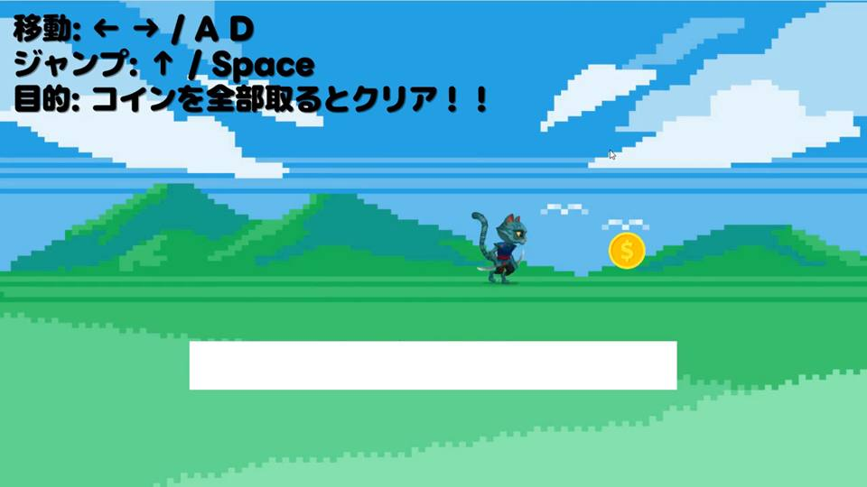
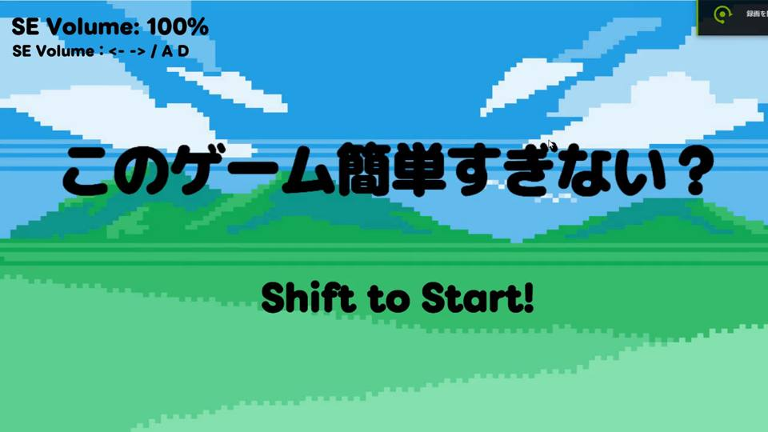
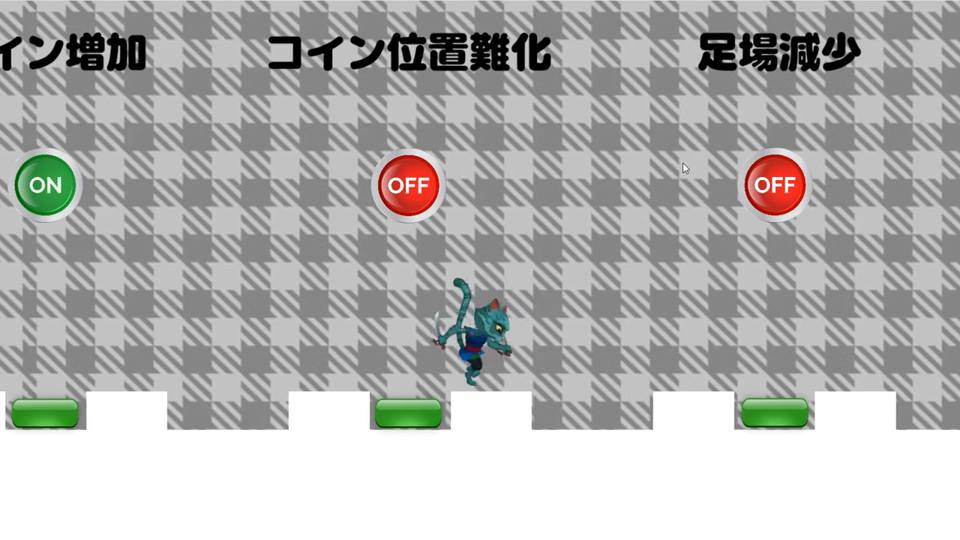
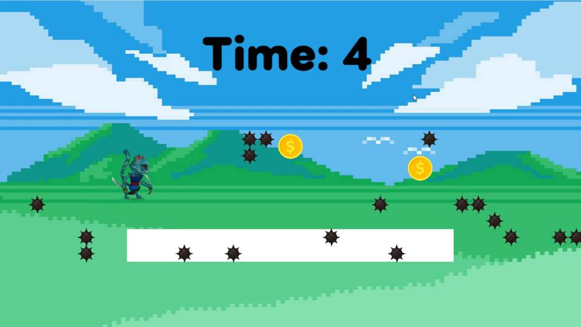

# このゲーム簡単すぎない？ | Unity / C# 2Dアクションゲーム

**個人制作した2D横スクロールアクションゲーム**です。コインを集めてステージをクリアし、6種類の難易度設定を組み合わせて記録に挑戦できます。



**[🎮 ブラウザでプレイ（unityroom）](https://unityroom.com/games/kantansuginai)**　｜　**[🎬 プレイ紹介動画を見る（約21秒・MP4）](docs/media/play_movie.mp4)**　｜　**[💻 実装コードを見る](Assets/Scripts/)**

> PCのWebブラウザとキーボード操作を想定しています。動画は提出用プレイ映像をWeb閲覧向けに圧縮したものです。

## ゲーム画面

| タイトル画面 | 難易度設定画面 | 高難易度のプレイ画面 |
| :---: | :---: | :---: |
|  |  |  |

画像は実際のプレイ紹介動画から切り出したものです。各画像をクリックすると大きく表示できます。

## ゲーム概要

キャラクターを操作してステージ内のコインをすべて集めるとクリアになるアクションゲームです。移動・ジャンプの基本操作に加えて、難易度を変更するスイッチを用意しています。各条件を組み合わせて挑戦でき、すべての難易度スイッチを有効にした状態でのクリアタイムをランキングに送信する仕組みがあります。

## 操作方法

- 左右移動：← / → または A / D
- ジャンプ：↑ または Space
- タイトル画面から開始：Shift
- タイトル画面の効果音音量調整：← / → または A / D

キーボード操作を想定しています。

## 実装した主な機能

| 機能 | 内容 | 主な実装 |
| --- | --- | --- |
| キャラクター操作 | 左右移動、ジャンプ、接地判定、落下時のリスタート | [PlayerController.cs](Assets/Scripts/PlayerController.cs) |
| コイン収集とクリア判定 | コイン取得時のスコア更新、全コイン取得でクリア | [CoinPickup.cs](Assets/Scripts/CoinPickup.cs)、[GameClearManager.cs](Assets/Scripts/GameClearManager.cs) |
| 難易度の切り替え | 6種類の条件をスイッチで設定し、ステージの構成やプレイヤーの挙動へ反映 | [DifficultySettings.cs](Assets/Scripts/DifficultySettings.cs)、[StageDifficultyApplier.cs](Assets/Scripts/StageDifficultyApplier.cs) |
| 制限時間 | 選択した難易度に応じた時間制限と、時間切れ時のリスタート | [StageTimer.cs](Assets/Scripts/StageTimer.cs) |
| クリアタイム・ランキング | 経過時間の計測とunityroomランキングAPIへのスコア送信 | [ClearTimeTracker.cs](Assets/Scripts/ClearTimeTracker.cs)、[UnityroomRankingSubmitter.cs](Assets/Scripts/UnityroomRankingSubmitter.cs) |
| 画面・演出 | タイトル、チュートリアル、クリア表示、効果音設定など | [TitleManager.cs](Assets/Scripts/TitleManager.cs)、[TutorialManager.cs](Assets/Scripts/TutorialManager.cs) |

### 難易度の6項目

- コイン数の増加
- コイン配置の難化
- 足場の縮小
- トゲの増加
- 着地時の強制ジャンプ
- 制限時間の追加

## 処理の構成

ゲーム内の処理は、役割ごとに複数のスクリプトへ分けています。

```text
難易度選択
  DifficultySettings
    ├─ StageDifficultyApplier → コイン・足場・トゲ・ジャンプ条件
    └─ StageTimer             → 条件に応じた制限時間

プレイとクリア
  PlayerController → CoinPickup
                         ├─ ScoreManager       → スコア更新
                         └─ GameClearManager   → コイン取得数とクリア判定
                                  └─ ClearTimeTracker → UnityroomRankingSubmitter
```

※ランキングへの送信は、すべての難易度スイッチを有効にして最終クリアした場合を対象としています。

## 開発で工夫した点

**操作と当たり判定：** 接地判定に `Physics2D.OverlapBox` を用い、接地中のみジャンプできる処理を実装しました。また、スプライトに合わせて当たり判定の大きさを調整できるようにしています。

**難易度の構成：** 難易度スイッチの状態を `DifficultySettings` に集約し、`StageDifficultyApplier` でコイン位置・足場・トゲ・ジャンプ条件へ反映しています。難易度ごとにゲーム全体を別実装にせず、設定の組み合わせで挙動を変えられる構成にしました。

**記録とランキング：** クリアタイムは `Time.realtimeSinceStartup` に基づいて計測し、所定の条件でクリアした際にunityroomのランキング機能へ送信する処理を実装しています。

## ランキング機能を利用する際の設定

**HMACキーはGitHubに保存していません。** ローカルでランキング機能を使う場合は、`Assets/Resources/unityroom-ranking-hmac.txt` に新しいキーを設定してください。キーがない場合はランキング送信を行いません。

過去に公開シーンへ設定されていたキーは再発行・無効化が必要です。設定手順と外部アセットの公開上の注意は、[機密情報・外部素材について](docs/SECURITY_AND_ASSETS.md) にまとめています。

## 開発環境とプロジェクト構成

- 開発形態：個人制作（企画・実装・調整・公開）
- 開発期間：2026年5月から約1か月、開発時間は約30時間（提出資料に記載）
- 言語：C#
- ゲームエンジン：Unity **6000.4.7f1**（`ProjectSettings/ProjectVersion.txt` に記載）
- 主な機能：Unity 2D Physics、Input System、unityroom client library
- 公開先：unityroom（WebGL）

主要なディレクトリ：

- `Assets/Scripts/`：ゲームの処理
- `Assets/Scenes/`：タイトル、ステージ、難易度設定画面
- `Assets/images/`、`Assets/sounds/`、`Assets/tiles/`：ゲーム用アセット
- `Packages/`：パッケージ設定
- `ProjectSettings/`：Unityプロジェクト設定

ローカルで確認する場合は、Unity Hubからこのリポジトリをプロジェクトとして開いてください。編集・実行にはプロジェクトに記載されたUnityバージョンを推奨します。

## 補足

- プレイヤーキャラクターはUnityの「2D Animated Characters samples」に含まれるNinja_Catを使用しています。背景や効果音にはフリー素材を利用しています。
- コーディングや不具合調査では生成AIを補助的に使用し、修正内容を確認したうえで実際に動作検証しました。

このリポジトリは個人制作・学習の過程を含むプロジェクトです。画像・音声などのアセットには第三者が権利を持つ素材が含まれる可能性があるため、コード以外の素材を再利用する際は個別に利用条件を確認してください。
